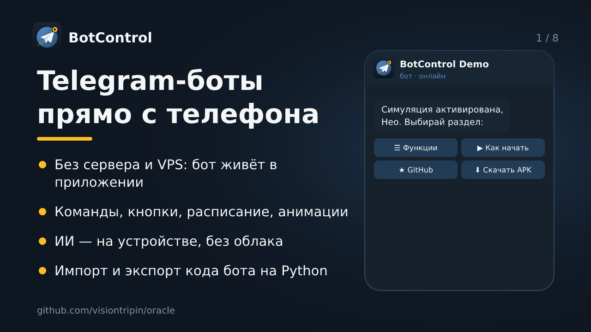

  

<h1 align="center">BotControl</h1>

<b>Telegram-боты прямо с телефона</b> — без сервера, VPS и Termux. 
Команды, кнопки, анимации, расписание, объявления и ИИ на устройстве.

  <a href="https://github.com/visiontripin/oracle/releases/latest"><b>⬇️ Скачать APK</b></a> ·
  <a href="https://t.me/AppBotcontrol_bot"><b>🤖 Демо-бот @AppBotcontrol_bot</b></a> ·
  <a href="docs/presentation.html"><b>📊 Презентация</b></a> ·
  <a href="docs/index.html"><b>🌐 Страница проекта</b></a>

## Как это работает

Обычному Telegram-боту нужен компьютер, который никогда не выключается:
аренда VPS, установка Python, автозапуск, туннели — и всё равно он падает,
когда что-то обновилось. **BotControl** убирает сервер: бот живёт в
Android-приложении на вашем телефоне.

- 🔐 токен от @BotFather вставляется в приложение и хранится в
  зашифрованном хранилище Android;
- 🧩 поведение настраивается кнопками: команда, фраза или нажатие →
  ответ, набор фраз, анимация, расписание или ИИ;
- 🧠 локальная модель (MediaPipe / LiteRT) работает на телефоне, без облака;
- 📥 готовый бот на Python можно импортировать как конфиг — код не
  исполняется, приложение только разбирает его в настройки.

## Начать за 3 шага

1. Скачать APK со [страницы релизов](https://github.com/visiontripin/oracle/releases/latest)
   и установить (разрешить установку из неизвестного источника).
2. Получить токен: @BotFather → `/newbot` → скопировать токен.
3. Приложение → «+ Добавить бота» → вставить токен → «▶ Запустить».

Подробнее — [презентация](docs/presentation.html) и [FAQ в приложении](docs/index.html).

## Что в репозитории

| Путь | Что там |
|---|---|
| [`tg-bot-control/android/`](tg-bot-control/android/) | исходники приложения (Kotlin + Jetpack Compose) |
| [`tg-bot-control/*-ready.py`](tg-bot-control/) | готовые конфиги ботов: Агент Смит, канал «Даром в ПЛ», бот-презентация |
| [`tg-bot-control/ПЕРЕДАЧА-КОНТЕКСТА.md`](tg-bot-control/ПЕРЕДАЧА-КОНТЕКСТА.md) | память проекта: состояние, грамматика импорта, ловушки |
| [`handoff/`](handoff/) | инструкции для продолжения работы в новом чате (txt прикладываются к релизам) |
| [`docs/`](docs/) | страница проекта и презентация (`presentation.html`, `presentation.pdf`) |
| [`tg-bot-control/branding/`](tg-bot-control/branding/) | логотип, аватар бота, слайды, генераторы |
| [`tg-bot-control/tools/`](tg-bot-control/tools/) | харнесс импортёра, фикстуры, CI-проверка изоляции ботов |

## Сборка

APK собирается в GitHub Actions (workflow `botcontrol-apk.yml`): пуш в ветку
и `[apk]` в сообщении коммита → тег `botcontrol-v<версия>-code<код>` и релиз
с APK. Локально нужен JDK 17 + Android SDK 35.

Текущая версия — **v1.7.0 (versionCode 33)**, следующий versionCode — **34**.

## Безопасность

Живых токенов ботов в репозитории нет и быть не должно. В git лежит только
`debug.keystore` — постоянный ключ debug-сборки, чтобы APK ставился поверх
предыдущего без потери ботов. Токен из удалённого архива
`botcontrol-handoff.zip` остался в истории git — его нужно отозвать в
@BotFather (`/revoke`).
